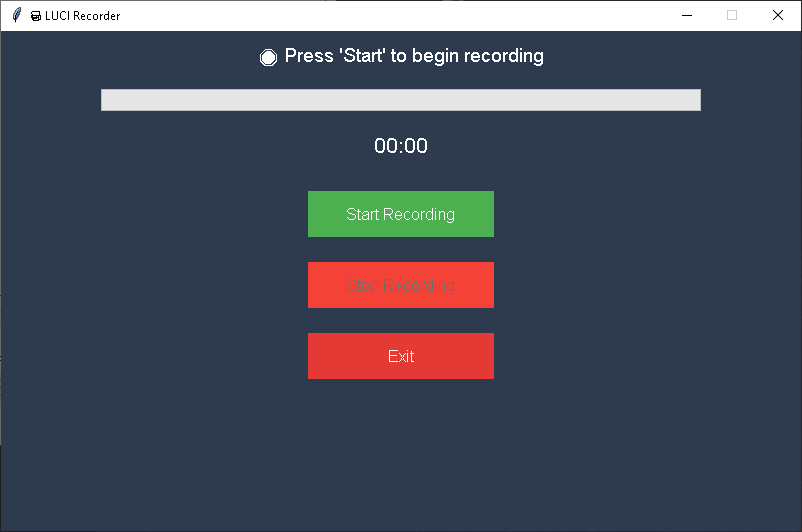

# 🖥️ OpenSource Screen Recorder


<p align="center">
  
  
  
  
</p>

<p align="center">
  <b>🎥 Lightweight • ⚡ Fast • 🐍 Python Powered • 🖥️ Cross-Platform</b>
</p>

<p align="center">
  A simple and lightweight screen recording application built with Python.
</p>

---

## 🌟 About The Project

**OpenSource Screen Recorder** is a lightweight screen recording tool built with **Python**.

Capture your entire screen or a selected region with a simple interface — without unnecessary bloat or complicated configuration.

The project is designed to be **simple, customizable, and open-source**.

---

## ✨ Features

* 📹 **Full Screen Recording**
* 🎯 **Selected Region Recording**
* 🎙️ **Microphone Input**
* 🔊 **System Audio Support**
* 🎞️ **MP4 / AVI Export**
* 🧊 **Minimal GUI**
* ⚡ **Fast & Lightweight**
* 🧩 **Open-Source & Customizable**
* 🖥️ **Windows Support**
* 🐧 **Linux Support**
* 🍎 **macOS Support**

---

## 🖥️ Application Preview

<p align="center">
  
</p>

> 💡 Replace `assets/main.png` with your actual application screenshot or demo GIF.

---

## 🔄 How It Works

```text
          🖥️ YOUR SCREEN
                 │
                 ▼
          🎯 Select Area
                 │
                 ▼
          📹 Start Recording
                 │
        ┌────────┴────────┐
        ▼                 ▼
   🎙️ Microphone      🔊 System Audio
        │                 │
        └────────┬────────┘
                 ▼
          🎞️ Video Output
                 │
          ┌──────┴──────┐
          ▼             ▼
        MP4            AVI
```

---

## 🛠️ Tech Stack

<p align="center">


</p>

### Libraries

* 🐍 **Python 3.7+**
* 👁️ **OpenCV**
* 🖱️ **PyAutoGUI**
* 🔢 **NumPy**
* 🎙️ **PyAudio**
* 🖼️ **Tkinter**

---

## 📦 Requirements

Before running the project, make sure you have:

```text
Python 3.7+
OpenCV
PyAutoGUI
NumPy
PyAudio
Tkinter
```

---

## 🚀 Installation

### 1️⃣ Clone the Repository

```bash
git clone https://github.com/luciferofx/opensource-screen-recorder.git
```

```bash
cd opensource-screen-recorder
```

### 2️⃣ Install Dependencies

```bash
pip install -r requirements.txt
```

### 3️⃣ Run the Application

```bash
python main.py
```

> Replace `main.py` with the actual entry-point filename if your project uses a different file.

---

## 📄 Requirements File

Your `requirements.txt` can contain:

```text
opencv-python
pyautogui
numpy
pyaudio
```

> `tkinter` is generally provided through the Python installation/system packages rather than installed from PyPI.

---

## 🎬 Recording Formats

The recorder supports:

```text
🎞️ MP4
🎞️ AVI
```

Choose the format that best fits your use case.

---

## 📂 Project Structure

```text
opensource-screen-recorder/
│
├── 📁 assets/
│   └── 🖼️ main.png
│
├── 📄 main.py
├── 📄 requirements.txt
├── 📄 README.md
└── 📄 .gitignore
```

---

## 🌍 Supported Platforms

| Platform   | Support |
| ---------- | ------- |
| 🪟 Windows | ✅       |
| 🐧 Linux   | ✅       |
| 🍎 macOS   | ✅       |

---

## 🔮 Future Improvements

* [ ] 🎥 Webcam Recording
* [ ] 🎙️ Better Audio Controls
* [ ] 🎯 Advanced Region Selection
* [ ] ⏱️ Recording Timer
* [ ] ⏸️ Pause / Resume
* [ ] 🖱️ Mouse Highlighting
* [ ] ⌨️ Keyboard Shortcuts
* [ ] 🎨 More GUI Themes
* [ ] ⚙️ Recording Quality Settings
* [ ] 📦 Portable Executable Builds

---

## 🐛 Troubleshooting

### PyAudio Installation Error

If PyAudio fails to install, make sure the required system audio dependencies are installed for your operating system.

### Tkinter Not Found

Verify that Tkinter is available in your Python installation.

### Recording Doesn't Start

Check:

```text
✓ Python version
✓ Required dependencies
✓ Screen permissions
✓ Microphone permissions
✓ Output directory permissions
```

---

## 🤝 Contributing

Contributions are welcome! ❤️

```bash
git checkout -b feature/new-feature

git add .

git commit -m "feat: add new feature"

git push origin feature/new-feature
```

Then open a **Pull Request** 🚀

---

## ⭐ Support

If you like this project, consider giving it a ⭐

<p align="center">
  ⭐ Star &nbsp; • &nbsp; 🍴 Fork &nbsp; • &nbsp; 🐛 Report Issues &nbsp; • &nbsp; 🤝 Contribute
</p>

---

## 👨‍💻 Developer

### 🔥 Luciferofx

**Python Developer • Tech Enthusiast • Open-Source Builder**

> 🐍 Building with Python
> 🖥️ Creating useful desktop tools
> ⚡ Exploring new technologies
> 🚀 Turning ideas into open-source projects

**GitHub:** https://github.com/luciferofx
---
## 👥 Contributors

<table>
  <tr>
    <td align="center">
      <a href="https://github.com/luciferofx">
        
        <br />
        <sub><b>Luciferofx</b></sub>
      </a>
      <br />
      <sub>👨‍💻 Author & Maintainer</sub>
    </td>
    <td align="center">
      <a href="https://github.com/ayush-jsx">
        
        <br />
        <sub><b>Ayush</b></sub>
      </a>
      <br />
      <sub>🤝 Contributor</sub>
    </td>
  </tr>
</table>
---

## 📜 License

This project is **open-source** and available for modification and customization.

---

<p align="center">
  <b>Made with ❤️ & Python by Luciferofx</b>
</p>
